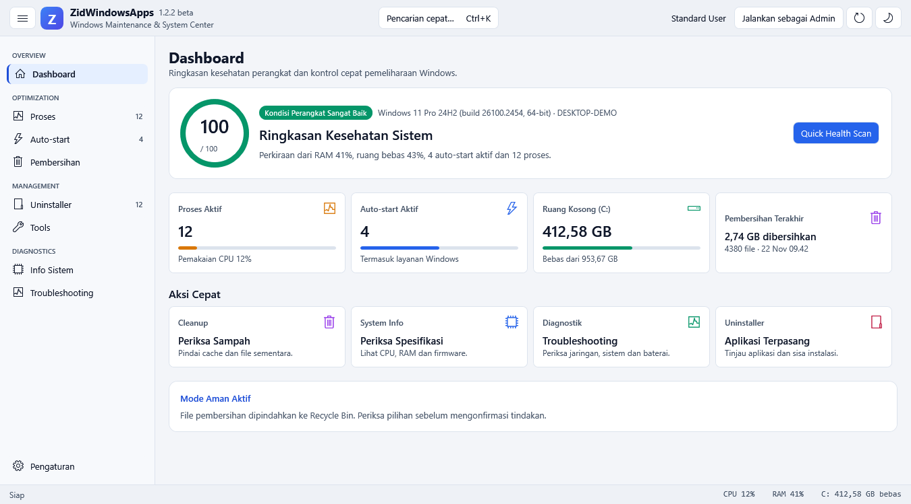
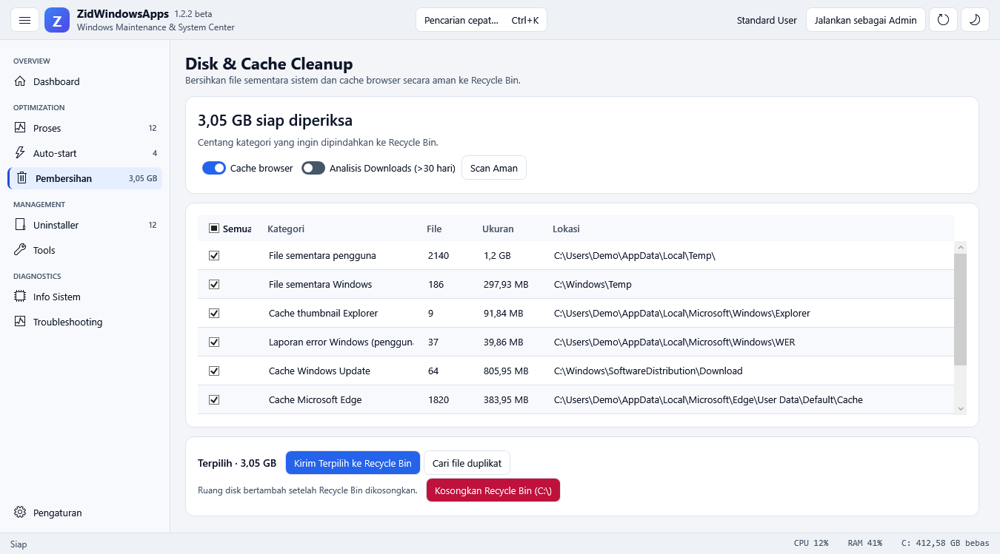
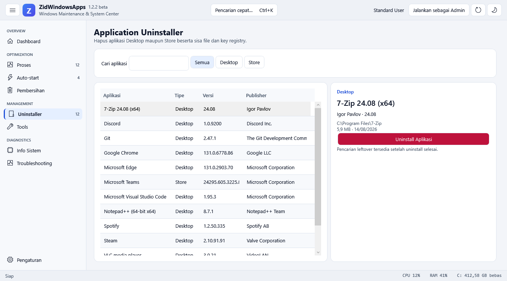
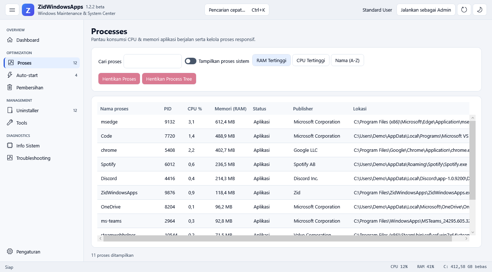
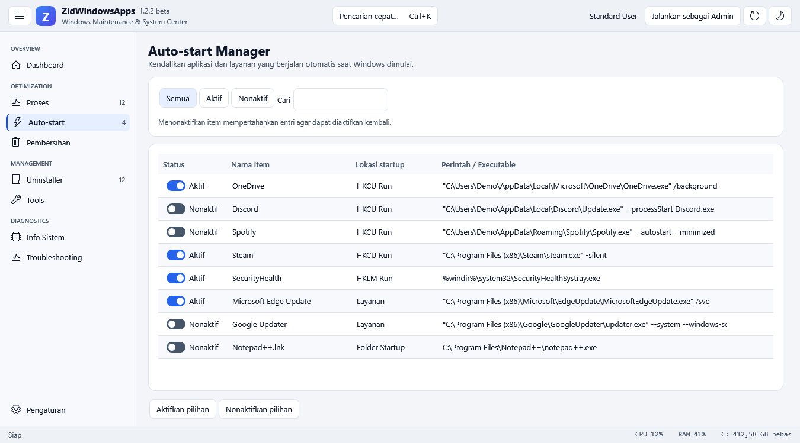
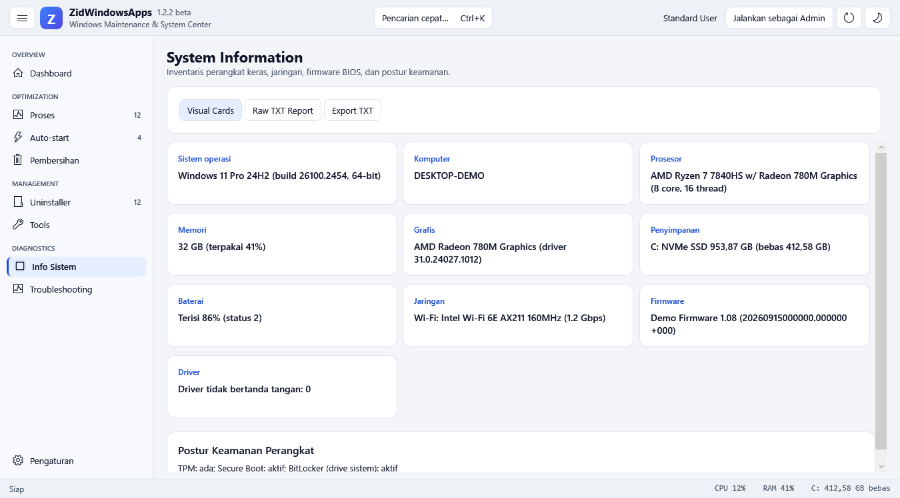
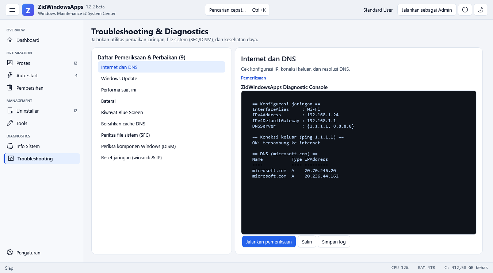
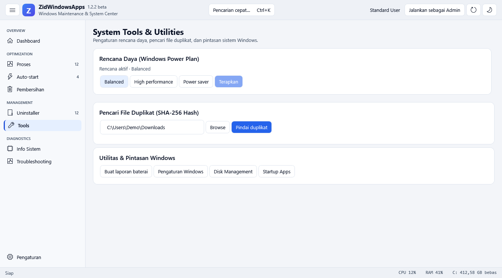
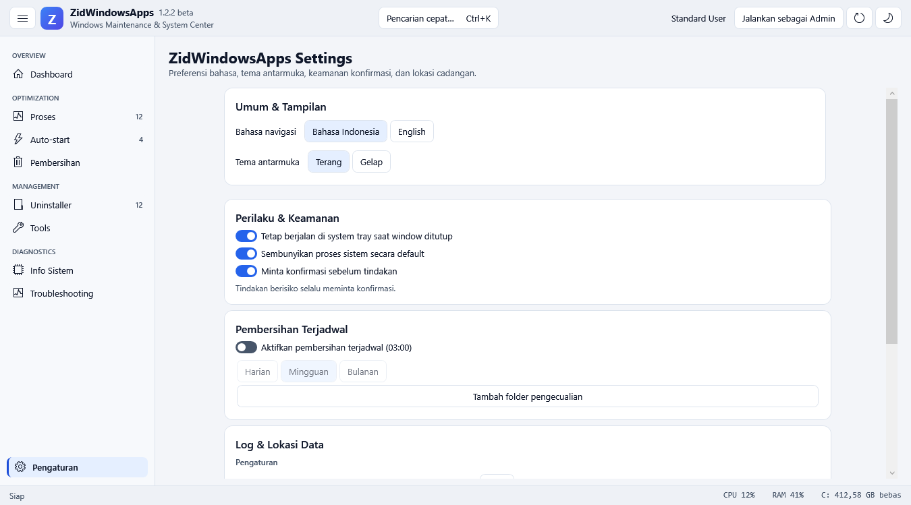

<div align="center">


# ZidWindowsApps

**A safe, all-in-one maintenance center for Windows 10 / 11.**
Processes, auto-start, uninstaller with leftover scan, junk cleanup, duplicates, system info, and troubleshooting — in one WPF app.

[](https://github.com/zidnammc/ZidWindowsApps/actions/workflows/ci.yml)
[](https://github.com/zidnammc/ZidWindowsApps/releases)
[](LICENSE)
[](https://github.com/zidnammc/ZidWindowsApps/releases)


[**Download**](https://github.com/zidnammc/ZidWindowsApps/releases) · [Features](#features) · [Screenshots](#screenshots) · [Build](#build-from-source) · [Changelog](CHANGELOG.md)



</div>

> [!NOTE]
> **Beta.** The current release is **v1.2.2 beta**. The UI text is Indonesian; English navigation labels can be enabled in Settings, and a full English UI is on the roadmap.

## Features

| Module | What it does |
|---|---|
| **Dashboard** | Health score from RAM, system-drive free space, auto-start items, and processes. Shows live CPU/RAM and your last cleanup. |
| **Processes** | CPU, RAM, publisher, and path. Closes apps politely before killing. Critical Windows processes are protected. |
| **Auto-start** | Enables/disables startup entries reversibly (the Task Manager `StartupApproved` mechanism), including third-party services. |
| **Cleanup** | Per-category scan: temp files, Windows Update cache, error reports, thumbnails, Edge/Chrome cache, and old Downloads (picked one by one). Files go to the **Recycle Bin**; empty it from the same page. Optional scheduled cleanup. |
| **Uninstaller** | Desktop and Store apps. After a successful uninstall, scans leftover files, folders, and registry keys. Registry keys are backed up to `.reg` first. |
| **Tools** | Power plans, SHA-256 duplicate finder, battery report, Windows shortcuts. |
| **System Info** | CPU, RAM, GPU, storage, battery, network, firmware, drivers, TPM, Secure Boot, and BitLocker. Exportable as TXT. Serial numbers are never read. |
| **Troubleshooting** | Network/DNS, Windows Update services, BSOD history, DNS flush, SFC, DISM, and network reset. |
| **Settings** | Theme, tray behaviour, confirmations, scheduled cleanup, excluded folders. |

Press **Ctrl+K** anywhere to jump to a module.

### Safety first

- Destructive actions (uninstall, registry deletion, disabling a service, emptying the Recycle Bin) **always ask for confirmation**.
- Cleanup never deletes permanently — it moves files to the Recycle Bin.
- `PathGuard` refuses container folders (Windows, Program Files, drive roots, user-profile roots) and your excluded folders.
- Everything runs locally. No telemetry, no network calls except the diagnostics you start.

## Screenshots

<table>
  <tr>
    <td><br><sub><b>Cleanup</b> — scan by category, send to Recycle Bin, then empty it</sub></td>
    <td><br><sub><b>Uninstaller</b> — desktop & Store apps, leftover scan after removal</sub></td>
  </tr>
  <tr>
    <td><br><sub><b>Processes</b> — CPU, RAM, publisher; system processes hidden by default</sub></td>
    <td><br><sub><b>Auto-start</b> — reversible on/off switches</sub></td>
  </tr>
  <tr>
    <td><br><sub><b>System Info</b> — hardware & security posture, TXT export</sub></td>
    <td><br><sub><b>Troubleshooting</b> — guided checks with console output</sub></td>
  </tr>
  <tr>
    <td><br><sub><b>Tools</b> — power plans, duplicate finder, battery report</sub></td>
    <td><br><sub><b>Settings</b> — theme, tray, confirmations, scheduled cleanup</sub></td>
  </tr>
</table>

<sub>Screenshots use anonymous sample data, rendered from the real UI with `tools/FluentReview <dir> readme`.</sub>

## Install

1. Download **`ZidWindowsApps-Setup-1.2.2-beta-win-x64.exe`** (≈ 47 MB) from [Releases](https://github.com/zidnammc/ZidWindowsApps/releases).
2. Run it and approve the Administrator prompt. Windows SmartScreen may warn because the installer is not code-signed — choose **More info → Run anyway**.
3. Follow the wizard (default folder `C:\Program Files\ZidWindowsApps`). The desktop shortcut is optional.

The package is self-contained — no .NET runtime needed. Upgrading over an older version keeps your settings. To uninstall, use **Settings → Apps → ZidWindowsApps**, or run `Uninstall.exe` in the install folder (this also removes the scheduled cleanup task).

**Requirements:** Windows 10 or 11, 64-bit. Some features (Windows Update cache, HKLM entries, services, SFC/DISM) need Administrator — use **Jalankan sebagai Admin** in the title bar.

The previous interface is still available: exit from the tray, then run `ZidWindowsApps.exe --legacy-ui`.

## Build from source

Prerequisites: .NET SDK 8+ and [NSIS 3](https://nsis.sourceforge.io) for the installer.

```powershell
dotnet build -c Release                       # app only
./build.ps1 -SelfContained                    # self-contained x64 installer (runtime bundled)
./build.ps1                                   # light installer, needs .NET Desktop Runtime 8+
./build.ps1 -SelfContained -Rid win-arm64     # Windows on ARM
```

Installers are written to `bin/packages/<version>/`. The first self-contained build downloads the runtime pack from NuGet.

<details>
<summary>Project layout</summary>

| Folder | Contents |
|---|---|
| `Infrastructure/` | Paths, settings, activity log, cleanup history, `PathGuard`, admin detection |
| `Models/` | Data classes |
| `Services/` | Windows logic without UI: PowerShell, Recycle Bin, cleanup, duplicates, processes, apps, auto-start, schedule, system info |
| `UI/Fluent/` | Fluent WPF shell (`Live/` = the app's pages; other files = Debug-only preview) |
| `UI/MainWindow*.cs`, `Resources/` | Legacy UI (`--legacy-ui`) |
| `installer/` | NSIS script (Modern UI 2) |
| `launcher/` | App icon and a small native launcher for Linux/CI builds |
| `tools/FluentReview/` | UI review and README screenshot tool |

XAML is loaded at runtime (not compiled to BAML), so the project also builds on Linux with reference assemblies in `refs/`.
</details>

## Contributing

Bug reports and small, focused pull requests are welcome — see [CONTRIBUTING.md](CONTRIBUTING.md). For security issues, follow [SECURITY.md](SECURITY.md).

## License

[MIT](LICENSE) © Zidna Rahmana
